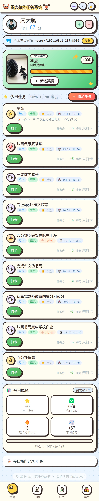
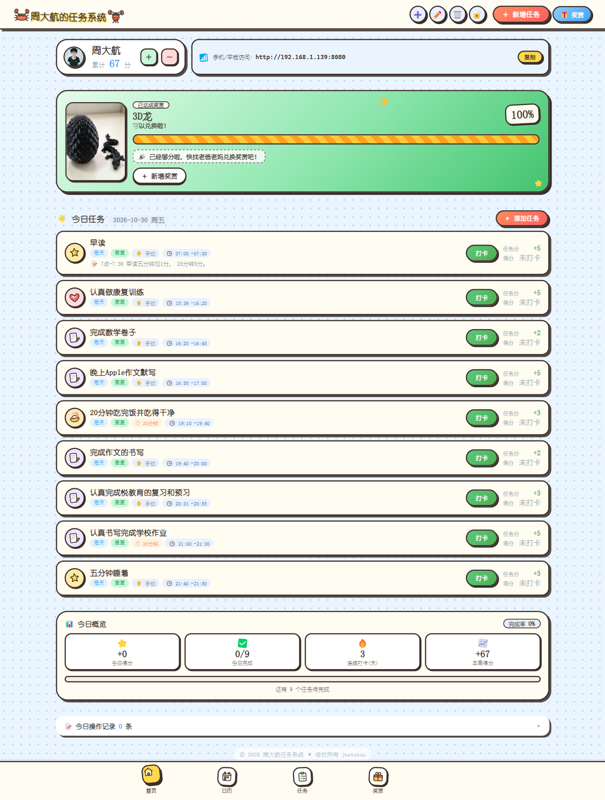
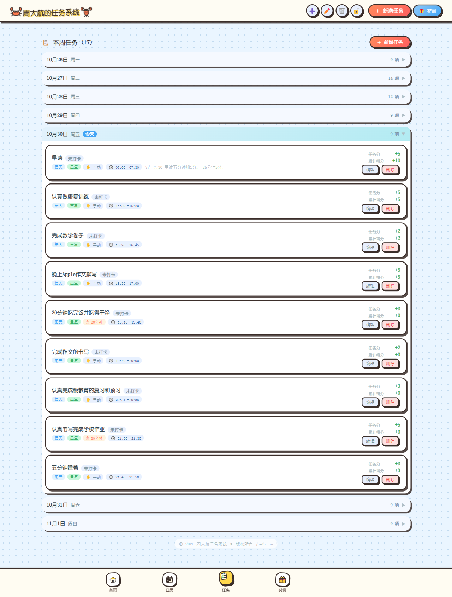
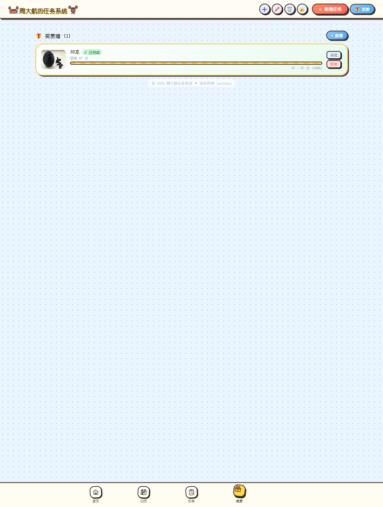
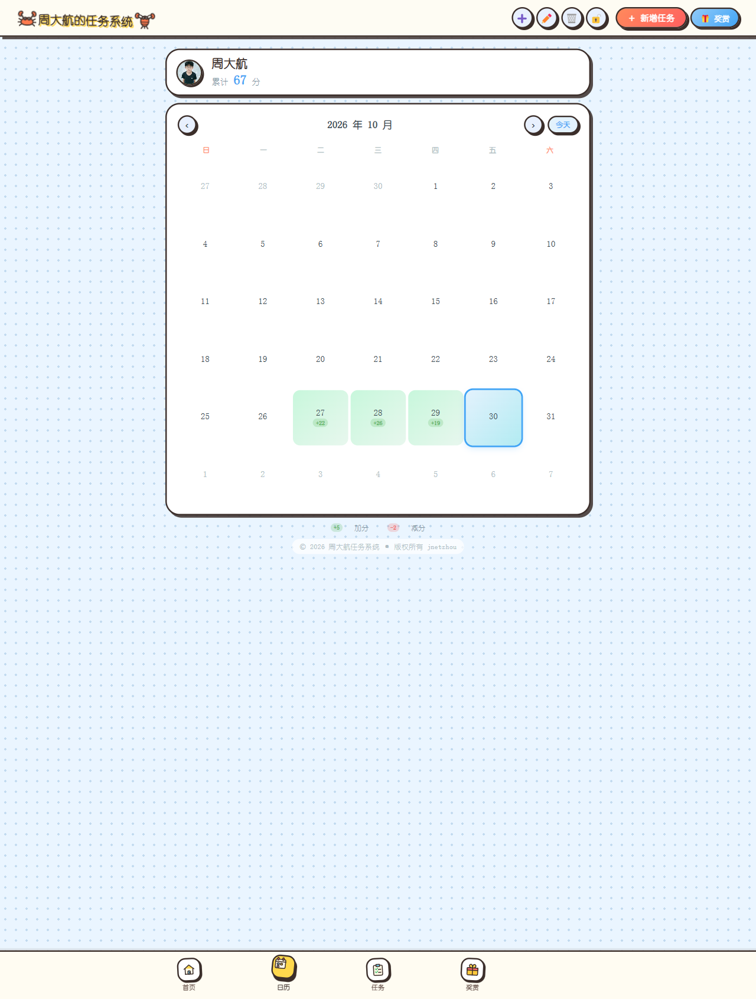
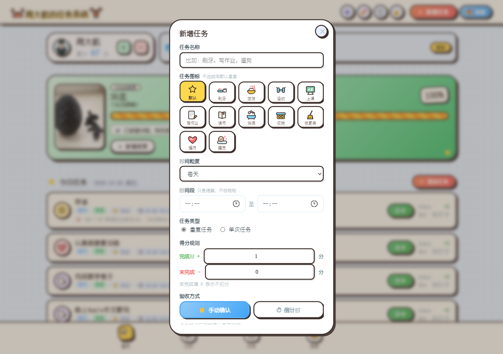

# 周大航任务系统 · 使用说明

面向家长和小朋友的完整操作手册。开发者/部署细节见 [README.md](README.md)。

---

## 目录

1. [一分钟上手](#一分钟上手)
2. [启动与访问](#启动与访问)
3. [界面导览](#界面导览)
4. [家长操作](#家长操作)
5. [小朋友打卡](#小朋友打卡)
6. [规则详解](#规则详解)
7. [奖赏怎么用](#奖赏怎么用)
8. [数据、同步与备份](#数据同步与备份)
9. [常见问题](#常见问题)
10. [速查表](#速查表)

---

## 一分钟上手

家长：

1. 双击「启动服务器.bat」（电脑需装 Python 3.8+）
2. 浏览器打开 `http://localhost:8080`
3. 点顶栏「🔒」设置家长密码
4. 点「＋ 新增任务」，填名称、时间段、完成加分
5. 点「🎁 奖赏」，设一个目标分数

小朋友：

1. 打开同一个地址（手机连同一 WiFi 用 `http://电脑IP:8080`）
2. 在「今日任务」里点任务卡片
3. 完成后点「✅ 完成了」，积分自动到账

---

## 启动与访问

### 启动

- 双击「启动服务器.bat」
- 或在本目录运行 `python server.py`（默认 8080，可 `python server.py 8090` 换端口）
- 启动窗口会打印两个地址：本机地址和局域网地址

### 电脑访问

`http://localhost:8080`

### 手机 / 平板访问

1. 手机和电脑连同一个 WiFi
2. 用启动时打印的局域网地址，如 `http://192.168.1.5:8080`
3. 首页顶部也会显示「手机/平板访问」地址，点「复制」发到自己手机即可
4. 首次启动会自动尝试放行 Windows 防火墙；若手机打不开，见[常见问题](#常见问题)

<p></p>

*手机端首页：顶部成员卡与奖赏冲刺卡，任务卡片按开始时间排列，底部为四个标签*

### 桌面快捷方式

点击顶栏左侧的螃蟹或右侧的龙虾图标，会在电脑桌面创建「周大航任务系统」快捷方式。

### 停止

双击「停止服务器.bat」，或在启动窗口按 `Ctrl + C`。

> 关掉服务器后网页仍能显示（浏览器有本地缓存），但多设备同步、自动备份会停止。建议平时保持开启。

---

## 界面导览

### 顶栏

| 位置 | 作用 |
| --- | --- |
| 左/右小图标 | 点击创建桌面快捷方式 |
| 标题 | 「当前小朋友昵称 + 的任务系统」，切换成员后自动变化 |
| ➕ / ✏️ / 🗑️ | 新增 / 编辑 / 删除小朋友（手机端收进「⋯」菜单） |
| 🔒 / 🔓 | 家长锁，点击上锁或解锁 |
| ＋ 新增任务 | 打开新增任务弹窗 |
| 🎁 奖赏 | 打开新增奖赏弹窗 |

### 底部标签（手机端显示）

- 首页：今日任务、奖赏冲刺、统计、操作记录
- 日历：按月查看历史打卡，点某天查看当天记录
- 任务：本周任务按天分组
- 奖赏：奖赏墙

### 首页元素

<p></p>

*电脑端首页：成员卡、奖赏冲刺卡、今日任务、今日概览、今日操作记录*

1. **成员卡**：头像、昵称、累计分数；右侧「＋ / －」手动加减分
2. **切换小朋友**：有 2 个及以上成员时，点头像弹出成员列表
3. **奖赏冲刺卡**：显示当前最接近的奖赏、进度百分比、还差多少分
4. **今日任务**：标题带日期和星期，如「🌟 今日任务 2026-10-30 周五」
5. **统计块**：今日得分、今日完成 X/Y、连续打卡天数、本周得分
6. **今日操作记录**：默认折叠，点标题展开；按时间从新到旧排列

### 页面截图

任务页（按周分组，今天默认展开）：

<p></p>

*任务页：本周 7 天分组，今天展开并带「今天」标签，每条任务右侧有状态徽章*

奖赏墙（进行中优先、状态与进度）：

<p></p>

*奖赏墙：矩形图标、名称、完成状态、目标分与进度*

日历页（按月查看，点击日期查看当天记录）：

<p></p>

*日历页：有记录的日期用绿色标记，底部为打卡/加分图例*

---

## 家长操作

### 家长密码与上锁

- 首次点顶栏「🔒」会让设置密码（至少 4 位，输入两次）
- 解锁状态下修改数据不需要密码；上锁后以下操作都需要先输密码：
  - 新增 / 编辑 / 删除小朋友
  - 新增 / 编辑 / 删除任务
  - 新增 / 删除奖赏
  - 打卡、撤销打卡
  - 手动加分 / 扣分
- 密码只保存加盐哈希，不保存明文
- 忘记密码可用内置万能密码（位置见 `js/models.js` 的 `MASTER_PASSWORD`，界面上不展示）
- 编辑小朋友资料时可以修改密码，留空表示不改

### 小朋友管理

| 操作 | 入口 | 说明 |
| --- | --- | --- |
| 新增 | 顶栏 ➕ | 填昵称、家长密码、选漫画头像或上传图片 |
| 编辑 | 顶栏 ✏️ 或「⋯ → 编辑」 | 可改昵称、头像、密码 |
| 删除 | 顶栏 🗑️ 或「⋯ → 删除」 | 会一并删除该成员的任务、奖赏和积分记录，不可恢复 |
| 切换 | 首页点头像 | 顶部标题、任务、奖赏、分数同步切换 |

### 新增 / 编辑任务

「＋ 新增任务」打开表单，字段含义：

| 字段 | 说明 |
| --- | --- |
| 任务名称 | 最多 20 字；选中图标时会自动帮你填名称，改过名称则不覆盖 |
| 任务图标 | 12 个漫画图标：刷牙、睡觉、作业、阅读、运动、吃饭、整理、手机、家务、音乐、遛狗、星星；不选用默认星星 |
| 时间粒度 | 每小时 / 每天 / 每周 / 每月（决定周期重置节奏） |
| 时间段 | 开始时间 + 结束时间。用于提醒，同时是打卡门槛：早于开始时间打卡会二次确认 |
| 任务类型 | 重复任务 / 单次任务。单次必须选「在哪天」；每周可再选「每周几」 |
| 得分规则 | 完成时 +N 分；未完成 −N 分（填 0 表示不扣分） |
| 验收方式 | 手动确认：点打卡后直接问「完成了吗」；倒计时：先倒计时 1–180 分钟（默认 5 分钟），结束再确认 |
| 备注 | 可选，显示在任务卡片上 |

编辑与删除注意：

- 删除任务会连带删除它的所有打卡记录，并回退对应积分
- 删除前会二次确认

<p></p>

*新增任务弹窗（表单较长可滚动，截图展示至验收方式；备注在最下方）*

### 手动加分 / 扣分

1. 首页成员卡点「＋」或「－」
2. 输入分数（1–999）和备注（可选，最多 30 字，如「主动帮忙洗碗」）
3. 备注会显示在「今日操作记录」对应条目的下方

手动加减分算进累计分数，但**不算打卡**（不影响连续打卡天数）。

### 撤销

在「今日操作记录」里展开后，点某条右侧「撤销」：

- 打卡记录撤销：分数回退，任务回到可打卡状态
- 手动加减分撤销：分数回退，该条记录从列表移除
- 撤销需要家长密码（上锁时）

---

## 小朋友打卡

### 标准流程

1. 在「今日任务」找到任务（已按开始时间排序）
2. 点任务卡片
3. 若还没到开始时间，会提示「还没到开始时间（xx:xx），是否仍要打卡？」——选取消则不打
4. 上锁时先输家长密码
5. 按验收方式继续：
   - **手动确认**：弹出「任务完成了吗？」，选「完成了」加分，选「还没完成」记录未完成并扣分（未设扣分则记 0 分）
   - **倒计时**：出现倒计时环，结束后再确认；倒计时中可取消
6. 卡片状态变为「✓ 已完成」，积分立即写入

### 状态含义

| 状态 | 含义 |
| --- | --- |
| ✓ 已完成 | 当前周期已打卡且完成 |
| ✗ 未完成 | 当前周期已记录为未完成（按规则扣分） |
| 未打卡 | 当前周期还没有记录 |

同一周期内不能重复打卡；完成后再次点击会提示「本周期已打卡」或「本周期已记录为未完成」。如需重打，请先在「今日操作记录」里撤销。

---

## 规则详解

### 单次任务 vs 重复任务

| 类型 | 出现时间 | 打卡后 |
| --- | --- | --- |
| 单次 | 只在「在哪天」指定的日期出现 | 当天保持已完成；次日起不再出现在任务列表，状态清零 |
| 重复 | 按时间粒度循环 | 当前周期内保持已完成；进入下一周期自动恢复可打卡，任务继续存在 |

### 重复任务的周期

| 时间粒度 | 重置规则 |
| --- | --- |
| 每小时 | 每个自然小时可重新打卡一次 |
| 每天 | 每天重置，次日恢复可打卡 |
| 每周 | 选「每周几」则只在那天出现；选「不限」则每天出现，按自然周重置 |
| 每月 | 按自然月重置 |

### 分数计算

- 累计分数 = 所有记录分值之和（打卡加分 + 手动加减分 − 未完成扣分 − 撤销回退）
- 允许为负分
- 删除任务/奖赏/小朋友会同步清理相关记录并回退积分

### 首页与任务列表的排序、分组

- **今日任务**：只显示选中日期的任务，按开始时间升序；未设时间的排最后
- **任务列表**：只显示本周（周一至周日），按日期分组
  - 今天的分组默认展开，其它日期折叠，点标题展开/收起
  - 每天的组内同样按开始时间排序，并显示每条任务的状态
  - 重复任务会出现在它生效的每一天，因此「每天」的任务本周会出现 7 次

### 统计口径

| 指标 | 口径 |
| --- | --- |
| 今日得分 | 今天所有记录的分值合计（含手动加减分） |
| 今日完成 | 今日应做任务中已完成的条数 / 今日应做任务数 |
| 连续打卡(天) | 从今天（今天没打则从昨天）往前连续有打卡记录的天数；手动加减分不算 |
| 本周得分 | 本周一 0 点至今的净得分 |

---

## 奖赏怎么用

### 新增奖赏

入口：顶栏「🎁 奖赏」/ 奖赏墙「＋ 新增」/ 首页达成后的「＋ 新增奖赏」

字段：

- 名称（最多 20 字）
- 目标分数
- 图标（12 个奖赏图标）或上传自定义图片

**注意：新增奖赏会把当前累计分数清零**，新奖赏从 0 分开始攒。

- 若当前分数大于 0，保存前会弹出确认「新增奖赏会把累计分数清零（当前 X 分），确定吗？」；取消则不新增
- 确认后写一条「新增奖赏「名称」，分数清零」的负数记录，可在「今日操作记录」查看，也可点 ↩ 撤销还原分数（奖赏本身不会被删除）
- 当前分数为 0 或负数时不弹确认、不写清零记录
- **编辑**已有奖赏不会清零分数

### 首页冲刺卡显示哪个奖赏

优先显示**尚未达成且目标分最低**的奖赏（最容易拿到的那个）；全部达成时显示目标分最高的那个，并提示「可以兑换啦！」。

未达成时文案是「靓仔，你还差 X 分就能得到我啦，加油！」。

### 奖赏墙

（界面截图见[页面截图](#页面截图)）

- 排序：未达成的「进行中」在前，同状态里最新创建的在最上面，已达成的排最后
- 卡片显示：矩形图标、名称、状态（✓ 已完成 / 未完成 · 还差 X 分）、进度 `当前分 / 目标分 (百分比)`
- 点矩形图标可放大预览，支持放大/缩小、Esc 关闭
- 可删除奖赏（不影响已获得的分数）

### 达成之后

- 首页冲刺卡出现「＋ 新增奖赏」按钮，点击直接设下一个目标（会清零累计分数，见上文）
- 奖赏达成本身不会自动扣分；是否兑换由家长线下约定
- 已达成奖赏仍留在奖赏墙，可继续保留记录

---

## 数据、同步与备份

### 数据存在哪

- 浏览器本地：`localStorage`
- 服务端：项目目录 `data.json`（小朋友、任务、奖赏、记录都在里面）
- 保存后约 300ms 自动推送到服务端；启动时按数据版本时间戳，新的一份生效

### 多设备注意

手机和电脑都可以操作同一份数据，但**不要在两台设备上同时改数据**，以最后写入的版本为准。

### 自动备份

- 每次写入后按需留档到 `backups/`
- 最快 5 分钟一份，内容没变化就跳过
- 保留：最近 120 份全留，另外每天最后一份保留 90 天

### 手动备份与恢复

双击「备份与恢复.bat」使用菜单，或命令行：

```bash
python backup_tool.py --list            # 查看备份（序号 1 = 最新）
python backup_tool.py --backup          # 立即备份
python backup_tool.py --restore 1       # 恢复最新一份
python backup_tool.py --restore data-20261027-153000.json
```

恢复后请刷新网页。恢复前建议先做一次「立即备份」，避免误操作。

### 迁移到新电脑

整个项目文件夹（含 `data.json`、`backups/`）拷贝过去即可，装好 Python 后启动服务。

---

## 常见问题

**手机打不开？**
确认手机和电脑同一 WiFi，地址用启动时打印的局域网 IP；仍不行检查 Windows 防火墙是否放行 8080。

**手机端很卡？**
窄屏已关闭毛玻璃、固定背景等高开销效果。首次打开需要下载资源，之后走强缓存会明显变快；更新版本后请强刷一次（手机浏览器里清除该站点缓存或重新打开）。

**iPhone 进页面没声音？**
浏览器限制无交互自动播放。页面加载 2 秒后会自动尝试；被拦截时右下角出现「点我播放」按钮。iOS 15.4+ / Safari 16.4+ 已切到 playback 音频会话，侧边静音开关打开也能出声；更老系统只能关闭侧边静音开关。

**忘记家长密码？**
用内置万能密码解锁（见 `js/models.js` 的 `MASTER_PASSWORD`），解锁后到「编辑小朋友」里改密码。

**任务第二天不见了？**
它是「单次任务」，只在指定日期生效，次日起不再出现。需要天天做的任务请改成「重复任务 + 每天」。

**重复任务在任务列表里出现很多次？**
任务列表是按天分组展示本周安排，「每天」的任务在 7 天里都会出现，这是预期行为。

**刚打卡的数字和之前对不上？**
先看「今日操作记录」是否有撤销或扣分；多设备时确认没有同时编辑。必要时用备份恢复。

**新增奖赏后分数变成 0 了？**
这是设计行为：新增奖赏会开启新一轮，保存前有确认提示，并把清零写成一条操作记录，可在今日操作记录里撤销还原。仅编辑奖赏不会清零；只想改目标分请用「编辑」，不要重新新增。

**根目录出现 `.data-*.tmp`？**
写入数据时的临时文件，正常会自动清掉；中断残留的，确认 `data.json` 正常后可直接删除。

**改了代码手机没变化？**
静态资源有一年强缓存，需要递增 `index.html` 里 js/css 的 `?v=` 版本号，并强制刷新。

---

## 速查表

### 家长

| 想做的事 | 怎么做 |
| --- | --- |
| 设置/修改密码 | 顶栏 🔒 / 编辑小朋友 |
| 上锁或解锁 | 顶栏 🔒 / 🔓，输密码 |
| 新增任务 | ＋ 新增任务 |
| 调整分数 | 成员卡 ＋ / －，可写备注 |
| 撤销误操作 | 展开今日操作记录 → 撤销 |
| 设新奖赏 | 🎁 奖赏，或达成后「＋ 新增奖赏」（会清零累计分数） |
| 看历史 | 日历页点日期 |
| 恢复数据 | 备份与恢复.bat → 从备份恢复 |

### 小朋友

| 想做的事 | 怎么做 |
| --- | --- |
| 看今天要做什么 | 首页「今日任务」，按时间排序 |
| 完成任务 | 点卡片 → 完成了 |
| 看离奖赏还差多少 | 首页冲刺卡 |
| 看本周安排 | 任务页，点日期展开 |
| 看所有奖赏 | 奖赏页，点图放大看 |

---

## 版权与许可

Copyright (c) 2026 jnetzhou <742408364@qq.com>

本项目采用 GNU Affero 通用公共许可证第 3 版（AGPL-3.0-or-later）授权，完整协议文本见 [LICENSE](LICENSE)。
